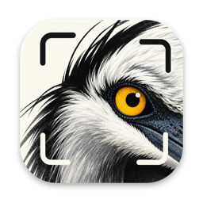
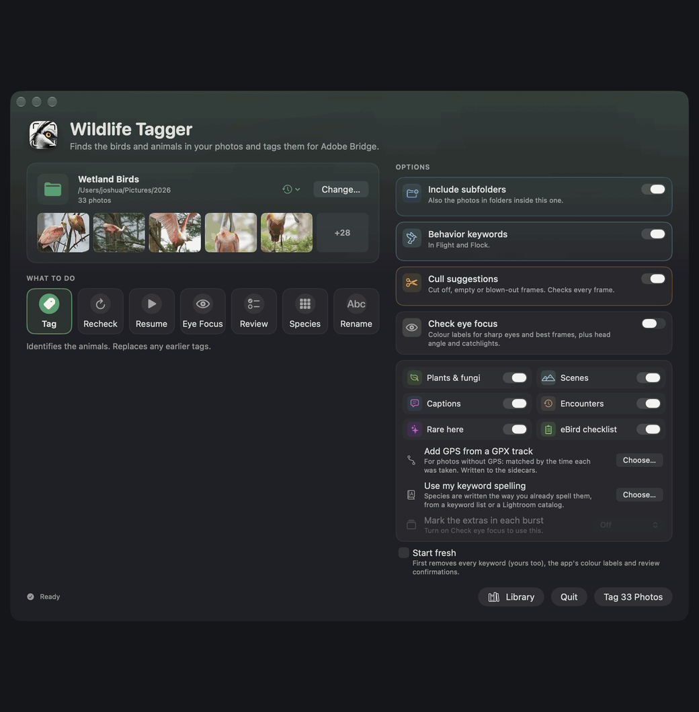
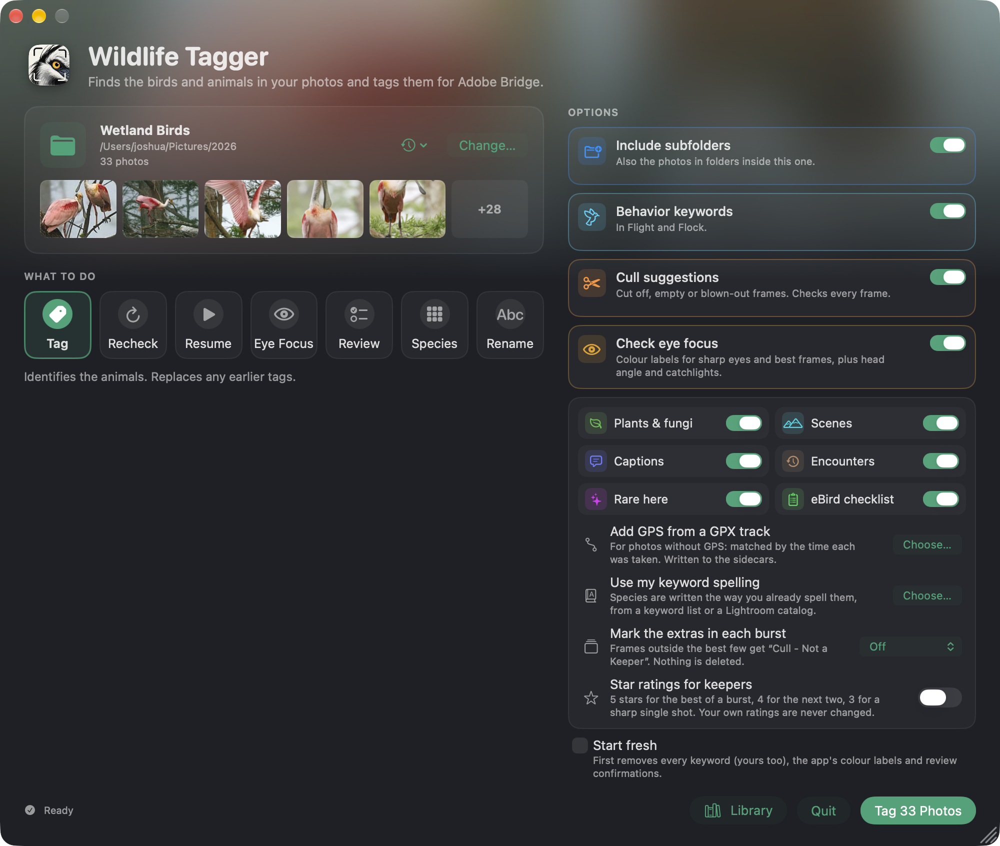
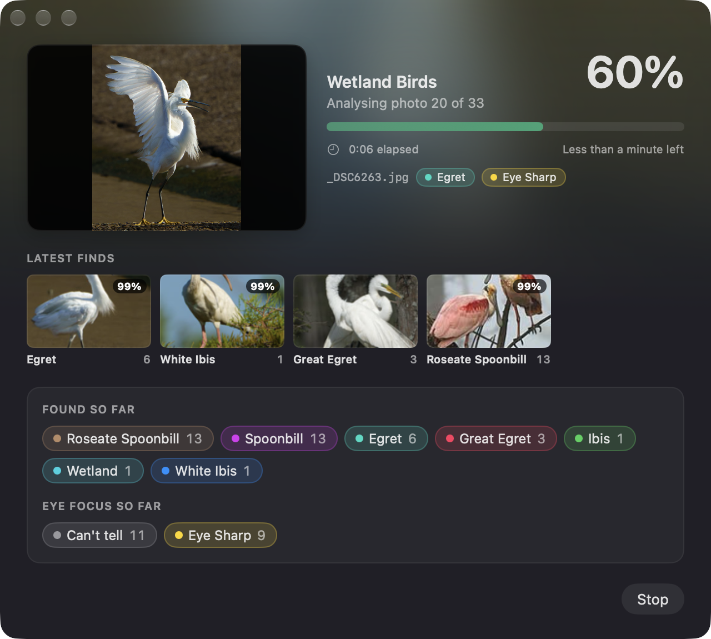
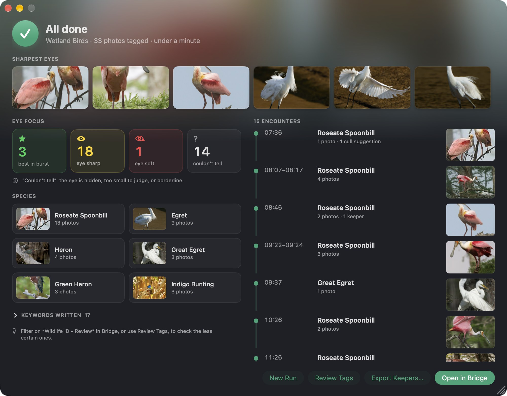
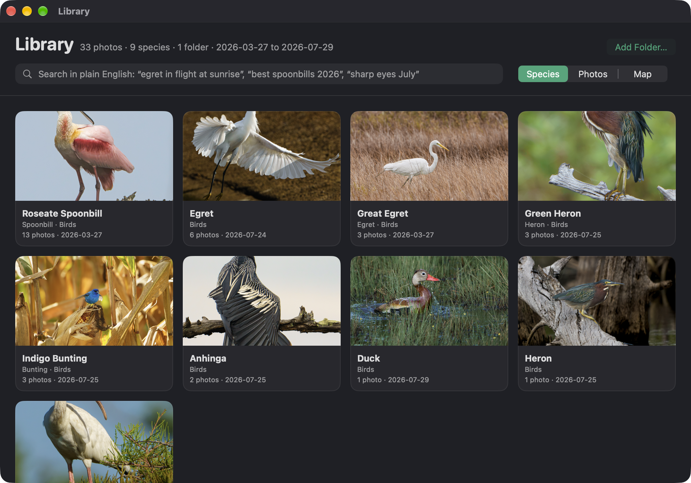
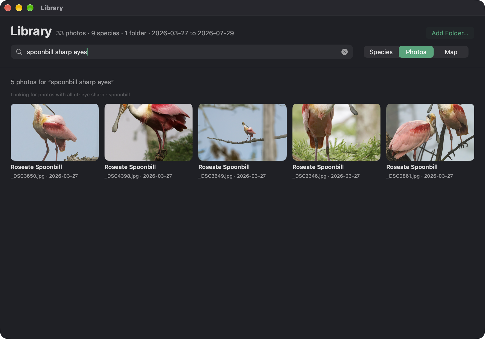
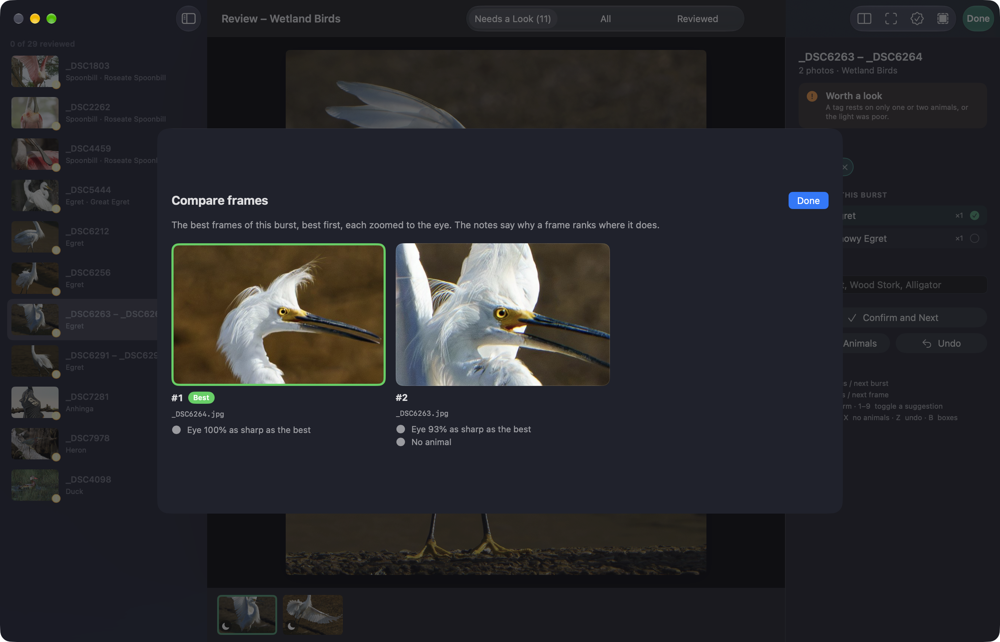
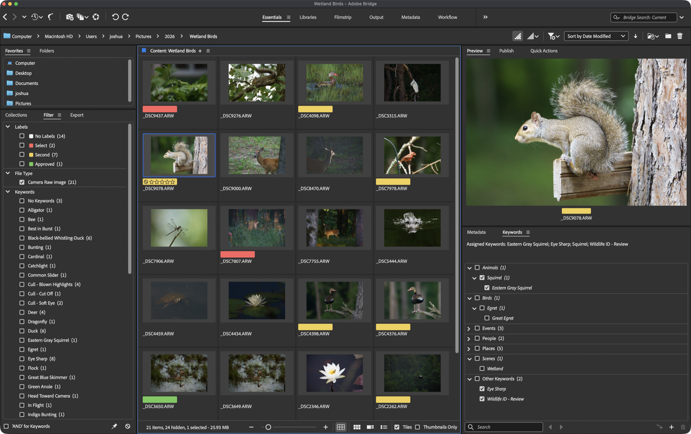

<div align="center">



# Wildlife Tagger

**Cull less. Shoot more. Let your Mac name every bird, beast and bloom in your photos.**

Wildlife Tagger identifies the wildlife in your RAW files and writes the species, behaviour,
focus checks and a ready-to-use caption straight into **Adobe Bridge**, **Lightroom Classic** and **Capture One**,
then keeps every trip in a searchable library. Built by a wildlife photographer, for wildlife photographers.

[](https://github.com/zjysrfjwv2-prog/wildlife-tagger-releases/releases/latest)


<br>



</div>

<br>

## Thousands of frames in. Organised keywords out.

You come home from a week in the field with 4,000 frames: egrets and herons, a deer at the tree line, ducks in
flight, a gator on a log, dragonflies, wildflowers, a sunset or two. Wildlife Tagger reads every one, tells you what's in it,
which frame of each burst is the keeper, and where the trip's best moments happened, so you can
find them in Bridge in seconds instead of scrolling for an evening.

| | |
|---|---|
| 🐦 **Names the species** | Birds, mammals, reptiles, insects, plants and fungi, from RAW, DNG, JPEG, HEIC, TIFF and PNG. Tuned for the birds of the US and Canada. |
| 🎯 **Shows how sure it is** | Every ID carries a confidence ("Egret 98%") on the photo as it's analysed, so you know which ones to trust. |
| 🛡️ **Flags threatened species** | Species on the IUCN Red List (Vulnerable, Endangered, Critically Endangered) get a badge and a *Conservation* keyword in Bridge, and a green, amber or red pin shows whether a species has been recorded near where you shot it. |
| 📍 **Knows where you were** | Every ID is checked against real sightings near the photo's GPS position, so a bird that has never been recorded there gets corrected to one that has. |
| 👁️ **Finds the sharp eye** | Marks the sharpest frame of each burst, flags soft eyes, and adds *Head Toward Camera* and *Catchlight* for the keepers. |
| ✂️ **Suggests culls** | Cut-off wings, empty frames and blown highlights get a keyword you can filter on. Nothing is ever deleted. |
| 🕊️ **Understands behaviour** | *In Flight* and *Flock* keywords, and encounters that group a burst of the same animal into a story with the weather at the time. |
| 📝 **Writes captions** | *"Wood Stork and White Ibis at sunrise · Waller County, Texas · September 12, 2026"* in the Description field, ready for upload. |
| 🌿 **Sees the scenery too** | Flowers, mushrooms, mountains, seascapes, wetlands, sunrises and sunsets are tagged as well. |
| 🧾 **eBird, GPS and rarities** | Export an eBird checklist, geotag photos from your phone's GPX track, and spot *Rare Here* species. |
| 🔎 **Library and search** | Every folder you tag joins one library. Search in plain English: *"egret in flight at sunrise"*, *"best spoonbills 2026"*, *"sharp eyes July"*. |
| 🆚 **Compare frames** | See the best frames of a burst side by side, zoomed to the eye, with the reason each one ranks where it does. Optionally keep only the best 1, 2 or 3 of each burst. |
| 🗺️ **Map** | See where each species was photographed, on a satellite map (needs GPS from the camera or a GPX track). |
| 🏷️ **Rename by species** | `2026-07-29_Great-Egret_DSC02421.ARW`, with sidecars following, and an Undo button. |
| 🔤 **Uses your keyword spelling** | Point it at a keyword list or a Lightroom catalog and species are written the way you already spell them. |
| 💡 **Lightroom Classic plugin** | Adds the keywords, captions, colour labels and star ratings to photos already in your catalog. Included in the app. |
| ⭐ **Star ratings for keepers** | Optional: 5 stars for the best frame of each burst, 4 for the next two, 3 for a sharp single shot, so Bridge and Lightroom sort by rating. A rating you set yourself is never changed. |
| 📤 **Export Keepers** | One button copies your best frames to a new folder, with optional web-size JPEGs that carry the caption and species names (never places or times). |

<br>

## Choose a folder. Press one button.

<div align="center">

</div>

Drop in a folder of photos, pick what you want to do (**Tag**, **Recheck**, **Resume**, **Eye Focus**, **Review**, **Species** or **Rename**),
choose your options (names, focus checks, culls, captions, encounters, star ratings and more), and press the big button.
Every option is visible at once, and your choices are remembered for next time. Drag the corner of the window to make
the whole app bigger or smaller.

<br>

## Watch it work

<div align="center">

</div>

A live view shows the photo being analysed and each new species as it turns up, so you can spot a wrong ID
while the run is still going. Models load in the background when the app opens, so tagging starts straight away.

<br>

## See what you got

<div align="center">

</div>

The results screen leads with your best frames, then how the eye-focus check went, the species you found
(each shown by its head, not the whole scene) and a timeline of the morning: when each animal appeared,
how many keepers you got, and what the weather was doing. The full keyword list is one click away.
**Review Tags** lets you confirm or correct anything in one click, **Export Keepers…** copies your best frames
somewhere to share, and **Open in Bridge** takes you straight to the keywords.

<br>

## Find any photo, any trip

<div align="center">

</div>

Every folder you tag is added to your **Library** (**File › Library…**, or ⌘L). You get every species you've photographed, with a close-up
of its head, how many frames and when. Add folders you tagged earlier with **Add Folder…**.

<div align="center">

</div>

Search in plain English and it tells you how it read your words. It understands species, behaviour (*in flight*), sharp eyes,
best frames, rare sightings, months, years and times of day. The **Map** tab shows where you've photographed each species.

<br>

## Pick the keeper

<div align="center">

</div>

In **Review**, press **C** to compare the best frames of a burst side by side, each zoomed to the eye, with the reasons they rank
the way they do. Turn on **Mark the extras in each burst** and the app keeps the best 1, 2 or 3 of every burst and tags the rest
*Cull - Not a Keeper*. Nothing is ever deleted.

<br>

## What lands in Bridge

<div align="center">

</div>

A folder of Sony RAW files in Bridge after one run. The Filter panel lists every species, behaviour and focus check with counts, so
*Deer*, *Dragonfly*, *Eye Sharp* or *Best in Burst* is one click away. The Keywords panel shows what was written to the selected photo.


```
Egret                          Snowy Egret
In Flight                      Best in Burst · Top 3 in Burst
Head Toward Camera             Catchlight
Scenes | Wetland               Plants | Pansy
Places | United States | Texas | Waller County
Conservation | Vulnerable                          (only for threatened species)
Encounters | 2026-09-12 | 06:54 Great Egret
Description: Great Egret at sunrise · Waller County, Texas · September 12, 2026
```

RAW files get a standard `.xmp` sidecar next to them. JPEG, HEIC, TIFF, PNG and DNG files get the keywords
inside the file. **Your picture data is never changed.**

<br>

## Using Lightroom Classic?

Lightroom reads the `.xmp` sidecars when you import, so photos you tag first arrive with their keywords. For photos **already in your
catalog**, the app includes a small plugin:

1. In Wildlife Tagger choose **Help › Install Lightroom Plugin…**, then restart Lightroom Classic.
2. Select photos in the Library module and choose **Library › Plug-in Extras › Apply Wildlife Tagger Keywords**.

Keywords keep their hierarchy (*Birds › Heron › Green Heron*). Captions and colour labels are only added where you have none, so nothing
you set is replaced. If you rename files with the app, do it before importing, because Lightroom tracks files by name.

<br>

## Your photos stay on your Mac

Everything runs locally on your computer. Photos are never uploaded. Only two optional lookups use the internet,
and they send species names and an approximate position, never an image: the location check (GBIF) and the weather
for encounters (Open-Meteo). You can turn the location check off.

<br>

## Get it

**You need:** a Mac with Apple silicon (M1 or later), macOS 14 Sonoma or newer, and about 10 GB of free space.

1. **[Download the latest version](https://github.com/zjysrfjwv2-prog/wildlife-tagger-releases/releases/latest)** (`Wildlife.Tagger.zip`) and unzip it.
2. Drag **Wildlife Tagger** into your **Applications** folder and open it.
3. macOS will say it can't verify the app, because it isn't from the App Store. Click **Done**, then open
   **System Settings › Privacy & Security**, scroll down and click **Open Anyway**. You only do this once.
4. The first run downloads the AI models (about 5.5 GB, a few minutes). After that it starts instantly.

**Updates arrive inside the app.** Choose **Wildlife Tagger › Check for Updates…**, or leave automatic checks on
and it will tell you when there's something new.

<br>

## Questions

<details>
<summary><b>Does it change my photos?</b></summary>
Never. RAW files stay untouched and get a sidecar file. Other formats get keywords written alongside the picture data,
which is left as it was. The only thing that renames files is the **Rename** task, which you start yourself and can undo.
</details>

<details>
<summary><b>Will it overwrite my own keywords?</b></summary>
Re-running a folder replaces the keywords the app wrote, but photos you confirmed in the review window are left alone, and
captions you wrote yourself are never replaced. Colour labels you set yourself are never changed.
</details>

<details>
<summary><b>How accurate is it?</b></summary>
Very good on clear birds and mammals; less sure on tiny, distant or partly hidden animals, and on insects that aren't close-ups.
When it isn't sure it says so: uncertain photos get a *Wildlife ID - Review* keyword, and the review window shows the other
candidates so you can fix them quickly.
</details>

<details>
<summary><b>What does it cost?</b></summary>
It's free.
</details>

<details>
<summary><b>Something went wrong. What do I send you?</b></summary>
Choose <b>Help › Show Log…</b>, click <b>Copy Log</b>, and paste it in an email.
</details>

<br>

## Want a supported version?

Wildlife Tagger is free today. I'm planning a **supported, paid version** for photographers who rely on it: a signed app that opens without any warnings, a licence that follows you across your Macs, and faster fixes.

**Already in the free app today:** the Lightroom Classic plugin, the library with plain-English search, and the map.

If that's something you'd use, **[join the waitlist](mailto:cinematicjosh@gmail.com?subject=Wildlife%20Tagger%20waitlist&body=Hi%20Josh%2C%20please%20add%20me%20to%20the%20Wildlife%20Tagger%20waitlist.%0A%0AI%20mostly%20use%3A%20Bridge%20%2F%20Lightroom%20Classic%20%2F%20other%3A%20%0AI%20shoot%3A%20)** and tell me what you use it for. Waitlist members get the founding-member price (planned at about $25, one-time) before it goes on sale. No payment now, and no obligation.

<br>

## Credits and licence

Made by **Joshua Smith**: [joshuasmithphotography.com](https://www.joshuasmithphotography.com) · [cinematicjosh@gmail.com](mailto:cinematicjosh@gmail.com)

Wildlife Tagger is free software under the **GNU AGPL v3**. The source code is included with every download.
It stands on the shoulders of open projects: [YOLO](https://github.com/ultralytics/ultralytics) for finding animals,
[BioCLIP 2](https://imageomics.github.io/bioclip-2/) for naming species, [OpenCLIP](https://github.com/mlfoundations/open_clip) for scenes,
[GBIF](https://www.gbif.org) and [Open-Meteo](https://open-meteo.com) for place and weather, the
[AP-10K](https://github.com/AlexTheBad/AP-10K) and CUB-200 datasets for the eye finders,
[ExifTool](https://exiftool.org) and [Sparkle](https://sparkle-project.org). Full notices are inside the app.
